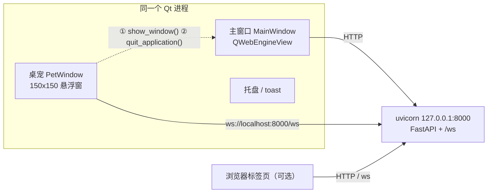

# 桌宠模块速查（配套图解：[PET_WINDOW_GUIDE.html](./PET_WINDOW_GUIDE.html)）

> 面向「要给桌宠加功能 / 提 PR」的人。文字版给检索与 diff，图解版给整体结构；行号以当前 `main` 为准。
>
> 图解版（HTML）是 `main` 的**静态快照**，投掷惯性（2026-11）只同步到了本文文字版。
>
> 历史文档 `docs/DESKTOP_PET_ANALYSIS.md` 描述的是旧结构（单文件 `desktop/pet_window.py` + `start_desktop.py`），当前已拆成混入、入口统一为 `app.py`，**不要照抄它的路径**。

## 1. 一句话定位

桌宠是**纯 Qt 悬浮窗 + WebSocket 消费端**：不读写数据库、不调 B 站 API、不含业务逻辑。它只做三件事——显示五态表情、把 `/ws` 消息渲染成气泡、通过鸭子类型调用主窗口两个方法。

## 2. 装配位置

```python
# app.py:219-224
main_window = MainWindow(web_port=port)
main_window.show()
pet_window = PetWindow(ws_port=port)   # 同一个 port
pet_window.show()
```

`PetWindow(ws_port=...)` 有三处依赖，**不要改签名**：`app.py:223`、`tools/verify_pet_p0.py:83`、`tools/verify_desktop_regressions.py:129`。



## 3. 文件职责

| 文件 | 行数 | 职责 |
|---|---|---|
| `__init__.py` | 111 | 混入组装 + 协议说明书 + `__all__` |
| `drag_mixin.py` | 354 | 悬停动画、长按/拖拽判定、位置持久化、把事件转给投掷钩子 |
| `geometry.py` | 334 | 窗口可见性夹紧（`clamp_rect`/`clamp_to_desktop`）、跨 DPI 拖动换算 |
| `base.py` | 286 | 窗口、UI、素材、`set_state()` 状态机 |
| `inertia.py` | 315 | **纯函数**：释放测速、阻尼/反弹推进、停止判定（不 import Qt） |
| `inertia_mixin.py` | 282 | 采速样本、`QTimer` 逐帧推进、单屏边界、「接住」与停飞 |
| `ws_thread.py` | 167 | QThread + websocket-client + 30s 心跳 |
| `menu_mixin.py` | 101 | 菜单显隐动画、定位、三个动作 |
| `ws_mixin.py` | 78 | 建线程、桥接 4 个信号、按 type 分流 |
| `notify_mixin.py` | 77 | 气泡显隐、5s 单定时器、eventFilter 收菜单 |
| `image_label.py` | 70 | 等比绘制 + `scale_factor` 属性（1.0–1.08） |
| `lifecycle_mixin.py` | 54 | closeEvent 清理顺序（含停飞）、退出代理 |
| `menu_panel.py` | 38 | 236×176 无边框卡片 + 三按钮 |
| `assets.py` | 33 | 三级资源目录候选 + 共享 logger |
| `runner.py` | 24 | 独立进程入口（主流程未使用） |

合计 2,324 行（`wc -l`）；`desktop/main_window.py` 另有 962 行。

## 4. 混入组装（MRO 顺序即优先级）

```python
class PetWindow(PetWindowBase, WsMixin, NotifyMixin, MenuMixin, DragMixin, LifecycleMixin, InertiaMixin, QWidget):
    pass
```

- `PetWindowBase.__init__` 末尾固定 `init_ui()` → `setup_websocket()`；子类覆盖 `setup_websocket` 即可离线化（`OfflinePetWindow` 技巧，测试与验收脚本都靠它）。
- 混入之间靠 `self.*` 互相调用（`DragMixin` 用 `self.toggle_menu()`、`self._sync_menu_position()`），新混入必须提供这些名字。
- **惯性是可选能力**：`DragMixin` 通过 `_notify_inertia("_inertia_on_press"/"_inertia_track"/"_inertia_on_release", ...)` 按名字转发，`InertiaMixin` 没装配时静默跳过（`getattr` 防护，与 `_keep_pet_size_after_move` 同一思路）。因此 `DragMixin` 不 import 任何惯性实现。
- 事件方法最后都 `super().mouseXxxEvent()` 落到 `QWidget`。

## 5. 状态机

| 常量 | 值 | 设置点 | 素材 | 现状 |
|---|---|---|---|---|
| `STATE_IDLE` | 0 | 初始化 / 连接成功 / 松手 / 气泡隐藏 / 飞行落定 | `assets/待机.png` | 在用 |
| `STATE_DRAGGING` | 1 | 长按 100ms 或位移 ≥6px | `assets/拖拽.png` | 在用 |
| `STATE_CLICKED` | 2 | 无 | 仅占位圆 | **死代码** |
| `STATE_NOTIFY` | 3 | `show_notification()` | 仅占位圆 | 半成品 |
| `STATE_FLYING` | 4 | 投掷起飞（`_inertia_on_release`） | 淡紫占位圆，放 `assets/飞行.png` 即生效 | 在用 |

`set_state()` 对不在 `self.images` 里的值静默忽略。新增状态需四处齐改：常量 → `images` → `load_placeholder_images()` → 测试宿主（`tests/test_desktop_pet_ui.py` 的 `_PetHost`）。

注意：飞行收尾只在 `current_state` 仍是 `STATE_FLYING` 时才切回待机，通知态不会被投掷收尾覆盖。

## 6. 消息协议

| type | data 字段 | 生产者 | 桌宠 | 浏览器 |
|---|---|---|---|---|
| `alert` | `bvid, video_id, type, level, message, details, created_at` | `modules/comment/_alerts.py:283` → `push_alert` | 收 | 忽略 |
| `toast` | `title, message, level, source, error_code` | `core/toast.py` → `web/main.py:745` 桥 | 收 | 收 |
| 其他 | — | — | 忽略 | 忽略 |

- 桌宠 → 服务端只有心跳 `{"type":"ping"}`（30s），服务端 `receive_text()` 后不回应。
- `/ws` 握手校验 `Origin`，跨站直接 `close(1008)`；`websocket-client` 不带 Origin 所以放行。
- `alert` **没有 `title` 字段**，气泡标题恒为「新通知」。

## 7. 关键数字

`150×150` 窗口 · `236×176` 菜单 · `100ms` 长按 · `6px` 位移阈值 · `1.06` 悬停放大 · `5000ms` 气泡 · `120ms` 收菜单 · `30s` 心跳 · `5000ms` 关窗等 WS 退出 · `8000` 默认端口。

投掷：`16ms` 帧间隔 · `250px/s` 起投 · `3800px/s` 上限 · `120ms` 采样窗口 · `12ms` 最小跨度 · `80ms` 停滞判定 · `λ=2.0/s` 阻尼 · `0.65` 弹性 · `40px/s` 停稳 · `6s` 兜底。

## 8. 扩展分级

| 级别 | 事项 | 落点 |
|---|---|---|
| A | 气泡改纯文本 / 标题正文分离 / alert 标题映射 | `notify_mixin.py` |
| A | 位置恢复校验是否在可用屏幕上（✅ 已做） | `base.py` |
| A | 补 `点击.png` `通知.png` 或删死状态 | `base.py` + `assets/` |
| A | 清掉重复 `colors` 字典与噪声注释 | `base.py` |
| A | 放 `assets/飞行.png` 替换淡紫占位圆（代码已就位） | `assets/` |
| B | 断线重连（1s→30s 退避）+ 心跳线程句柄化 | `ws_thread.py` |
| B | 离线视觉态（新 `STATE_OFFLINE` 或透明度） | `base.py` + `ws_mixin.py` |
| B | 跨屏拖动后重新夹住、菜单复用 `screenAt()`（✅ 已做，9dd102d） | `drag_mixin.py` / `menu_mixin.py` |
| B | 投掷的挤压/拖尾、落定音效 | `inertia_mixin.py` + `assets/` |
| B | 投掷参数做成用户可调（`QSettings` 覆盖键） | `inertia.InertiaConfig` |
| C | 「舆情预警实况」接真实数据（需新 API/新 type） | 服务端 + 桌宠 |
| C | 定向推送（`ConnectionManager` 加 client_id/频道） | `web/main.py` |
| C | 多实例 / 独立进程常驻 | 全局 |

## 9. 坑清单（真实存在）

1. **没有重连**：断线只 `logger.warning`，注释写的「显示离线状态」没有实现。
2. **气泡富文本未转义**：`setText(f"<b>{title}</b><br>{message}")`，`message` 来自评论内容可能被当标签解析。
3. **alert 无 title**：业务预警永远显示「新通知」。
4. **心跳线程无句柄**：每次 `on_open` 新建 daemon 线程，加重连前必须先管住。
5. **位置持久化与飞行抢跑**：飞行中不写 `QSettings`，只在松手和落定各写一次；别在 tick 里调 `_save_position_within_desktop()`，它会按可见区夹紧并与物理对抗。
6. **消息无结构校验**：`data` 非 dict 时 `.get()` 抛异常，该条消息丢失。
7. `STATE_CLICKED` 死状态、`colors` 字典重复定义、鸭子类型单例假设、通知态无素材。
8. **飞行计时器是唯一的重复型 `QTimer`**：`closeEvent` 必须 `_inertia_stop()`，否则窗口销毁后仍收 tick；按下、不可见、落定也要停（分别见 `_inertia_on_press`、`_inertia_tick`、`_inertia_stop`）。
9. **`tools/verify_desktop_regressions.py` 仍有 2 项历史遗留红**（`draggingState`/`draggingAsset`）：它按旧语义断言「按下即 `STATE_DRAGGING`」，与现在「长按 100ms 或位移 6px」的模型不一致。同脚本的 `windowMoved` 已由 #137 的后续提交修好（所有屏 DPR 相同时 `_fit_target_to_cursor_screen` 直接放行）。**不是新功能引入的回归**，跑基线时别误判。

## 10. PR 纪律

**必须**：新混入放 `desktop/pet_window/xxx_mixin.py` 并在 `__init__.py` 注册、同步 `tests/test_desktop_pet_ui.py` 的 `_PetHost`、状态四处齐改、新 type 只在 `ws_mixin.on_ws_message` 加 `elif`、日志走 `.assets.logger`、定时器默认 `QTimer(self)`+`setSingleShot(True)`（**例外**：投掷飞行需要连续帧，用重复 `QTimer`，`_ensure_inertia_timer()` 有说明）、素材放 `assets/` 根。

**不要**：改 `PetWindow(ws_port=...)` 签名、把 `setup_websocket` 搬进 `__init__`、改窗口 flags、在 `QThread.run` 里碰 QWidget、在事件回调里抛异常、往 `requirements.txt` 加依赖、把「接真实数据」和渲染优化混一个 PR、把投掷物理写进事件回调（放 `inertia.py`）、让投掷跨屏（边界取松手所在屏的可用区）。

```bat
cd /d D:\\\\FishTool
set "QT_QPA_PLATFORM=offscreen"
.venv\\Scripts\\python.exe -X faulthandler -m pytest tests/test_desktop_pet_inertia.py tests/test_desktop_pet_ui.py tests/test_desktop_websocket.py tests/test_desktop_dpi_scroll.py -q
.venv\\Scripts\\python.exe tools\\verify_pet_p0.py
.venv\\Scripts\\python.exe tools\\verify_desktop_regressions.py
```

`set` 的引号不能省：`set QT_QPA_PLATFORM=offscreen && ...` 会把 `&` 前尾空格并进变量值，Qt 解析平台插件名失败直接 `0xC0000409` 崩进程（详见 `docs/TEST_BASELINE_AND_DESKTOP_RUNBOOK.md` §3）。

**基线（2026-11，投掷惯性落地后）**：`pytest tests/test_desktop_pet_inertia.py tests/test_desktop_pet_window_geometry.py tests/test_desktop_pet_ui.py -q` → 104 passed；`pytest tests/test_desktop_pet_ui.py tests/test_desktop_websocket.py tests/test_desktop_dpi_scroll.py -q` → 40 passed；`tools/verify_pet_p0.py` → 7 项全 true。（依赖走 `uv`：`uv sync --group dev`；临时补装可用 `uv pip install --python .venv\\Scripts\\python.exe pytest pytest-asyncio`。）

## 11. 投掷惯性（已实现）

一次「快速拖动 → 松手」，桌宠按释放速度继续滑行，在**单块屏幕的可用区**内反弹并逐渐减速；慢拖、停住再松手、单击都不会触发。

分层：

- `inertia.py`：纯函数。`sample_velocity()` 判释放速度，`step_flight()` 推进一帧，`InertiaConfig` 是唯一参数表。**不 import Qt**，可脱离事件循环单测（`tests/test_desktop_pet_inertia.py`）。
- `inertia_mixin.py`：Qt 胶水。采「窗口自身的 `pos()` 位移」当速度（= 用户看到的速度，跨 DPI 不用折算）、松手时快照松手所在屏的 `availableGeometry()`、用重复 `QTimer` 逐帧 `move()` 并复用拖拽的「移动三件套」（`move` → `_keep_pet_size_after_move` → `_sync_menu_position`）。
- `drag_mixin.py`：只提供三个钩子时机（按下 / 拖动一帧 / 松手）。

「慢拖不投掷」三道闸（缺一都会误触发）：

1. 采样点 <2 或首末跨度 < `25ms` —— 一次事件里连续派发的 press/move/release 跨度≈0，验收脚本正是这种派发方式；
2. 末次采样距释放 > `80ms` —— 先停住再松手；
3. 合速度 < `250px/s`。

不变量（改代码时不要破坏）：

- **不跨屏**：飞行边界在松手瞬间快照一次，全程不变；位置异常（拔屏/改分辨率）由落定后的 `clamp_to_desktop` 兜底。
- **不穿墙**：`step_flight` 内 dt 夹在 `[0.1ms, 50ms]`，单轴反射最多 3 次，超限贴边停住。
- **一定会停**：速度 < `40px/s` 或飞行 > `6s` 强制结束，结束帧速度归零、位置在边界内。
- **不会崩**：tick 里的异常一律吞掉并停飞（`logger.error`），不冒泡到 Qt。
- **可接住**：任意键按下立即停飞、位置不变；这次松手只停飞不弹菜单（`_suppress_click_menu`，`DragMixin` 读一次即清）。

调手感只改 `inertia.InertiaConfig` 的默认值，`tests/test_desktop_pet_inertia.py::test_default_config_matches_agreed_handles` 是参数契约，改参数要同步它和上文「关键数字」。
