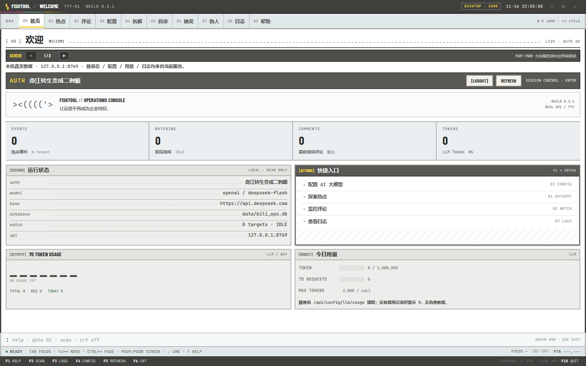
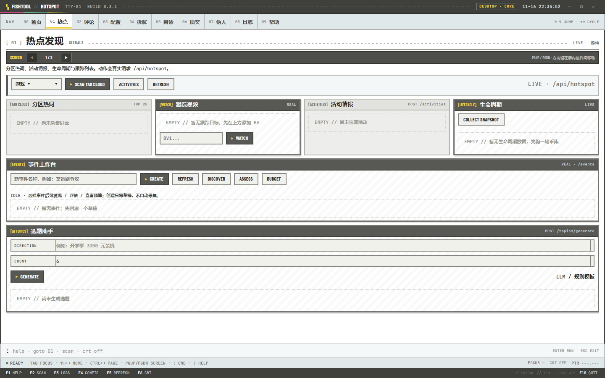
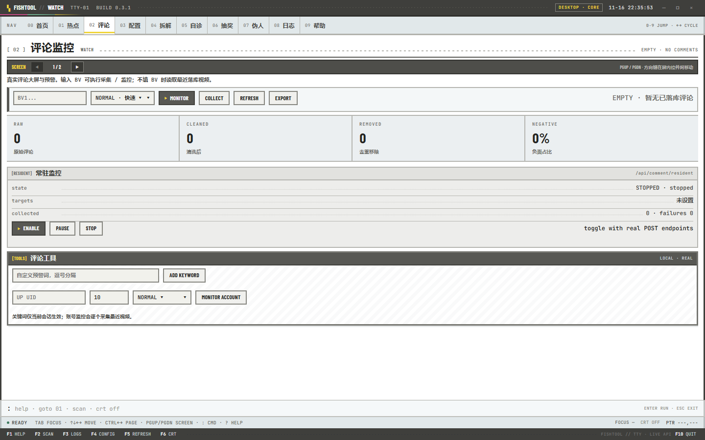
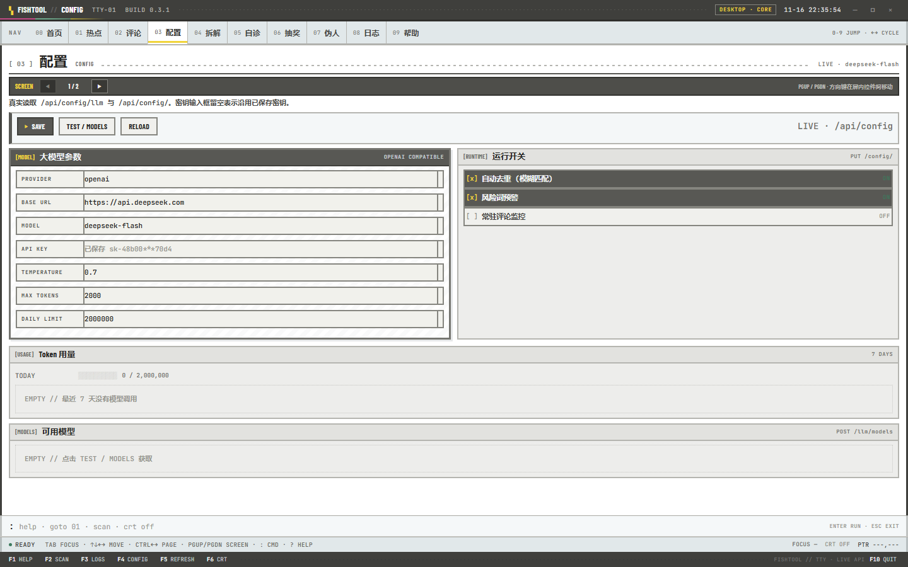
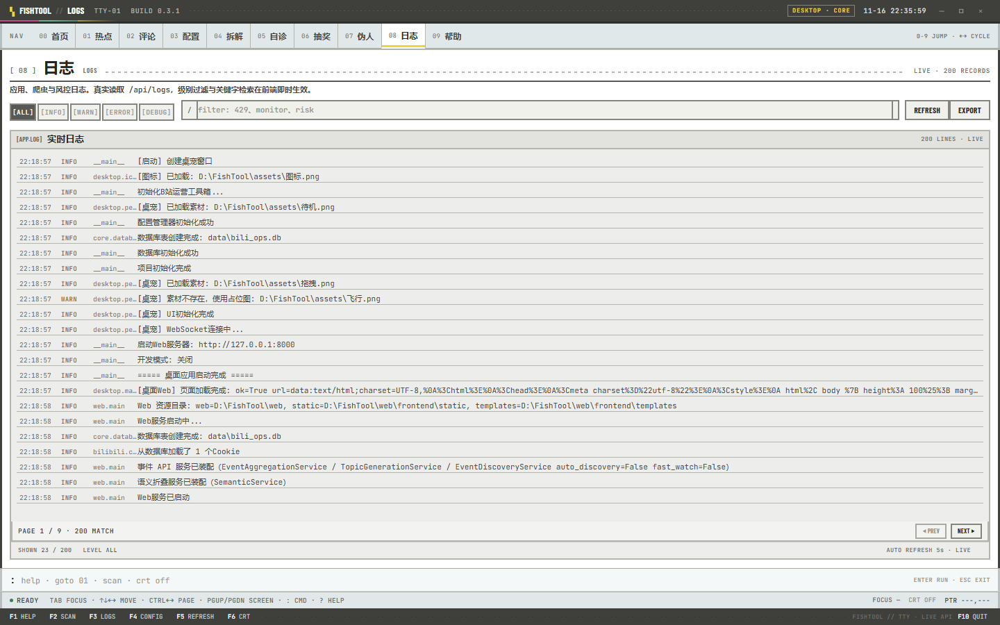
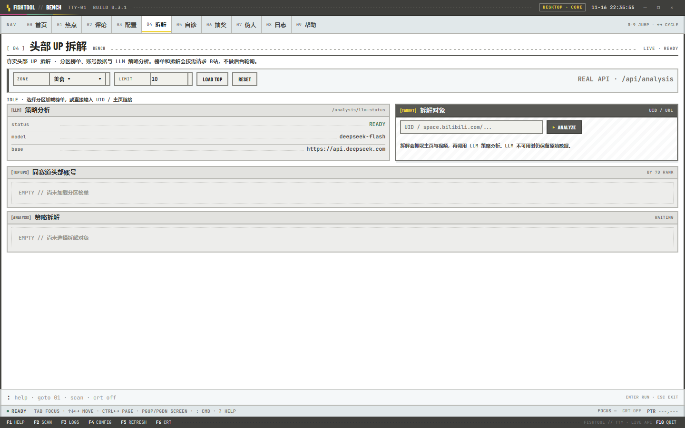
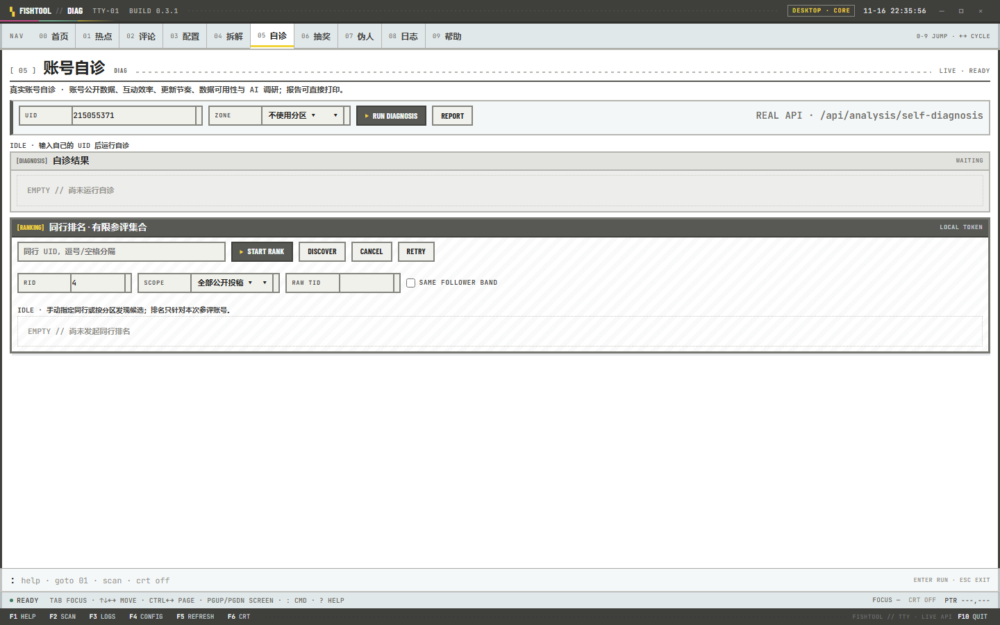
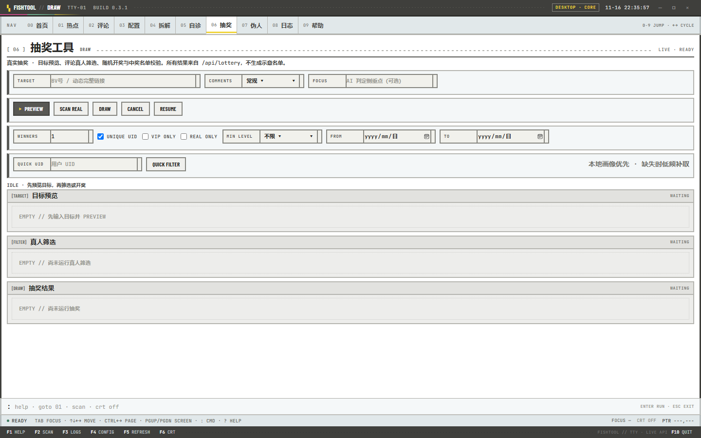
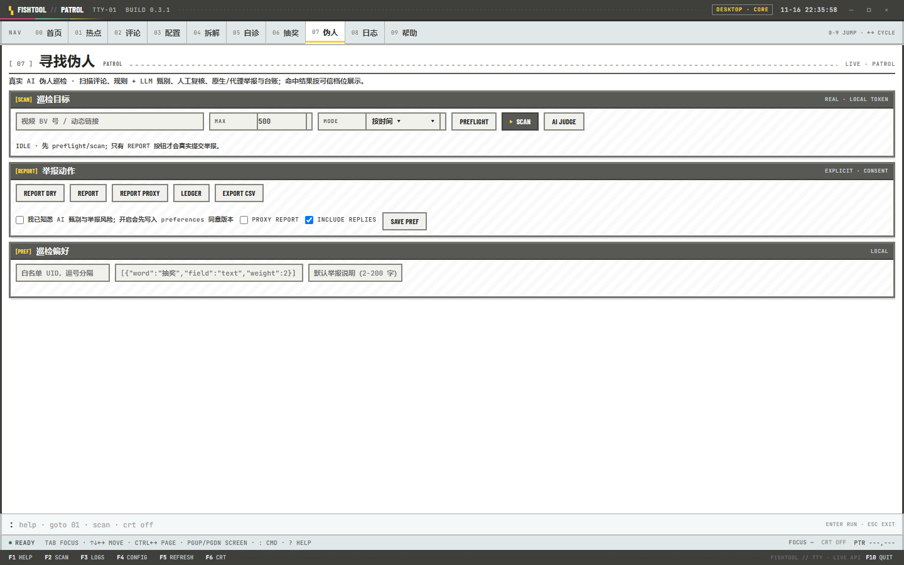

# FishTool // TTY —— 真实核心前端

> 10 个页面全部接真实数据：首页 / 热点 / 评论 / 配置 / 拆解 / 自诊 / 抽奖 /
> 寻找伪人 / 日志 / 帮助。事件工作台、语义折叠、AI 伪人巡检、同行排名、账号监控、
> 日志导出等正式 WebUI 的主要工具也已搬入 TUI。当前改动留在工作区，未提交 PR，
> 也未新建分支。


## 现在是什么

这不是静态视觉稿。页面启动后会读取本机的真实登录态、配置、Token 用量、跟踪列表、
评论大屏、预警与日志；采集、监控、保存配置、扫码登录等动作走真实后端。

- **桌面版默认**加载这套 TUI。窗口无边框，页面标题栏就是窗口标题栏：
  可拖动、双击最大化/还原、边缘缩放；右上角最小化 / 最大化 / 关闭到托盘。
- **Web 版**在 `/tui` 打开这套 TUI；`/` 仍保留完整正式 WebUI，方便回退。
- 托盘菜单可在「返回正式界面 / 打开 TUI」之间切换；切换会重新加载当前页面。
- 高级工具（04 拆解 / 05 自诊 / 06 抽奖 / 07 寻找伪人）已接真实接口；事件工作台、
  语义折叠、AI 伪人巡检、同行排名等也已加入对应页面，少数运维级细节仍在正式 WebUI。
- 所有内容页使用 **内部 SCREEN 分屏**（PGUP/PGDN、j/k、◀ ▶ 切换），不再依赖
  纵向滚动条；1366×768 / 1200×750 / 1600×900 / 1920×1080 已验证每屏完整显示。
  日志页按可用高度显示 16–32 行一页的显式分页，同样没有滚动条。
- 视觉改为纯白无纹理底 + 黑/白/灰面板 + 小面积亮黄；只读信息模块用灰色底，可交互模块用亮纸底 +
  灰色标题，不再用黑白撞色。信号黄只用于焦点/主操作。
- TUI 信息层级重排：首页是 AUTH 命令条 + 2×2 会话/快捷入口/用量/预算卡片；热点是
  四列状态卡 + 事件工作台；寻找伪人拆成巡检目标 / 举报动作 / 偏好三段；抽奖的输入、
  执行、筛选、结果各自成命令带。
- 下拉框改为 TUI 原生交互：聚焦时 ↑/↓ 只移动焦点，**Enter/Space 才打开**；
  打开后 ↑/↓ 选、Enter 确认、Esc 关闭。

## 启动

```bash
python app.py                    # 桌面版（默认 TUI）
python app.py desktop --classic  # 桌面版加载正式 WebUI
python app.py web                # Web 服务：/tui 为 TUI，/ 为正式 WebUI
```

访问：

- TUI：`http://localhost:8000/tui`
- 正式 WebUI：`http://localhost:8000/`

桌面窗口右上角的三个按钮依次是：最小化、最大化/还原、关闭到托盘。
关闭到托盘后可从系统托盘重新打开；退出请用托盘菜单的「退出」。



## 数据与动作

| 页面 | 真实数据 | 已接动作 |
| --- | --- | --- |
| 00 首页 | `/api/auth/status`、`/api/config/llm`、`/api/config/llm/usage`、`/api/hotspot/watch`、`/api/hotspot/events`、`/api/comment/dashboard`、`/api/logs/`、`/api/config/` | B站扫码登录、登出、刷新、快捷跳转、F10 关闭到托盘 |
| 01 热点 | 分区列表、跟踪列表、生命周期、最近发现轮、选题库、事件工作台 | 分区切换、词云任务、活动情报、AI 选题、选题状态、生命周期采集、事件创建/发现/评估/成员决定/预算/机会反馈 |
| 02 评论 | 评论大屏、情感分布、日期趋势、去重原因、Top10 声量、预警、常驻监控、语义折叠 | 单视频采集/监控、账号监控、自定义预警词、预警已读、常驻开启/暂停/停止、语义任务与人工决策、CSV 导出 |
| 03 配置 | LLM 配置、运行开关、7 天用量 | 保存配置、测试/拉取模型、开关写回 `/api/config/`、热重载、任意配置键写回 |
| 04 拆解 | 分区列表、头部 UP 榜单、UP 账号数据、LLM 策略分析 | 加载榜单、拆解 UP、AI 策略分析 |
| 05 自诊 | 账号公开数据、互动效率、更新节奏、数据可用性、分区基准、AI 调研、标签词云、同行排名 | 运行自诊、同行候选发现/排名/取消/重试、打印/导出报告 |
| 06 抽奖 | 目标预览、焦点模板、快速筛选、真人筛选、候选/中奖名单、中奖校验 | 预览、快速筛选、筛选、开奖、取消/继续、校验 |
| 07 寻找伪人 | 评论巡检、AI 甄别、可信档位、举报台账、白名单/偏好 | preflight、scan、AI judge、举报 dry-run/native/proxy、台账、CSV |
| 08 日志 | `/api/logs/` 最近 200 条 | 级别过滤、关键字检索、刷新、问题日志导出、5 秒自动刷新、按高度 16–32 行/页分页 |
| 09 帮助 | 键位、命令、范围与运行环境说明 | 静态文档 |

WS：`/ws` 的 `type=toast` 消息会写入状态栏，断线按 5 秒重试。

### 已补的高级工具

- **事件工作台**：事件列表、草稿创建、成员 proposed/accepted/rejected、发现任务、评估、预算、暂停/激活、机会列表与采用/拒绝/发布反馈。
- **语义折叠**：预检、偏好/consent、任务创建、进度、分组/原文、撤销整组、拆分/允许单条、取消、继续、分页。
- **同行排名**：分区候选发现、手动同行名单、冻结 run、取消/重试、百分位/名次、自诊报告引用。
- **AI 伪人巡检**：独立 07 页面；preflight、扫描、AI 甄别、评论档位、举报 dry-run/native/proxy、举报台账、CSV 导出。
- **账号监控/预警**：账号多视频汇总、自定义预警词、预警已读、采集进度轮询。
- **日志/登录**：问题日志导出、B站登出、配置热重载、快速筛选与焦点模板。

以上写操作都需要用户显式点击；语义/巡检的同意版本会先写入 preferences，native 举报不会自动执行。

















## 桌面无边框

- `MainWindow` 在 TUI 模式下设置 `Qt.FramelessWindowHint`；正式 WebUI 仍保留系统标题栏。
- Windows 使用原生 `WM_NCHITTEST`：
  - 标题栏左侧 → `HTCAPTION`（系统拖动、双击最大化、Snap）；
  - 四边/四角 → `HTLEFT` / `HTTOP` 等（原生缩放）；
  - 右侧 112px 窗口按钮区域 → `HTCLIENT`，交给页面点击。
- 非 Windows 使用 QWebChannel 的 `startSystemMove` / `startSystemResize` 回退。
- 页面按钮通过 QWebChannel 调用 `WindowBridge`：最小化、最大化/还原、关闭到托盘、查询最大化状态；
  桥文件是 `/static/js/qwebchannel.js`（Qt 自带客户端，LGPL/GPL 多许可）。
- 窗口默认 1440×900；最小 1200×750。TUI 在 1366×768 / 1200×750 / 1600×900 /
  1920×1080 都做过实机 QtWebEngine / Chromium 验证；页面内分屏后无需纵向滚动。

## 键盘与焦点

| 键位 | 作用 |
| --- | --- |
| `TAB` / `SHIFT+TAB` | 下一个 / 上一个焦点 |
| `↑ ↓ ← →` | 页面控件之间移动 |
| `CTRL` + `←` / `→` | 上 / 下一个页面 |
| `0` — `9` | 直接跳页 |
| `j` `k` / `PageUp` `PageDown` | 上 / 下一屏；日志页上 / 下一页 |
| `◀` `▶` / SCREEN 按钮 | 用鼠标切换内部屏幕 |
| `ENTER` / `SPACE` | 激活；下拉先打开；输入框进入编辑 / 再按确认 |
| `:` 或 `/` | 命令行 |
| `?` / `F1` | 帮助浮层 |
| `F2` | 当前页扫描：词云 / 评论监控 / 榜单 / 自诊 / 抽奖筛选 / 伪人扫描 |
| `F5` | 重新读取当前页 |
| `C` / `F6` | CRT 扫描线 |
| `F10` | 桌面端关闭到托盘 |
| `ESC` | 关闭浮层 / 退出输入 / 回到当前标签页 |

- 方向键按屏幕空间移动焦点（↑↓优先同列、←→优先同行）；顶部标签页聚焦时 `←/→` 切页。
- 输入框聚焦时方向键先移动焦点；Enter 或点击进入编辑，再 Enter 确认；直接输入也会进入编辑（数字输入默认只读，Esc 取消修改）。
- 复选框/单选框聚焦时整条标签显示黄框和浅灰底；Space / Enter 切换，方向键移动焦点。命令行的 `↑/↓` 保留历史。
- 焦点控件 2–3px 实线描边 + 信号黄定位条；鼠标/键盘焦点进入 panel 时标题栏加重，不再用纯黑反白。
- 鼠标指针为低对比字符单元格 `+`；拖影是 12 个粒子池，按时间在约 260–320ms 内淡出，
  不再是固定位置跟随的“贪吃蛇”；状态栏 `PTR 列,行`；键盘操作不依赖鼠标。

## 兼容与边界

- 兼容 Chromium 83 语法：不使用 flex gap、`:is()` / `:where()`、`inset`、`replaceAll`；
  焦点态使用 `:focus` / `:focus-within`。
- 真实 API/WS 只允许同源请求；TUI 页面从 `/tui` 提供，静态资源走 `/static`。
- 少数平台级细节仍以正式 WebUI 为准：事件 source_policy 的原始 JSON 编辑、语义同意的完整费用披露；
  TUI 已覆盖日常运营主链路和运维开关。
- 所有页面都以真实接口为空/失败时显示空状态或错误，不伪造数字、名单或榜单。
- 默认桌面版已切到 TUI；需要完整功能时用 `--classic` 或托盘「返回正式界面」。
- 当前改动不提交 PR；后续需要版本分支时再单独处理。

## 文件

```
tui-demo/
├── index.html          # 10 个页面 + 登录/帮助浮层 + 窗口控件
├── tui.css             # 纯白无纹理底、灰阶层级、SCREEN 分屏、时间衰减拖影
├── tui.js              # 路由、键盘、焦点、分屏、下拉、命令、CRT、指针
├── tui.live.js         # 真实 API / WS、核心页面渲染与动作
├── preview/            # 真实运行截图
└── README.md
```

相关后端/桌面入口：

- `web/main.py`：`GET /tui` 返回 TUI 页面。
- `desktop/main_window.py`：默认 TUI、无边框、托盘切换。
- `desktop/window_bridge.py`：窗口按钮桥 + Windows 原生命中测试。
